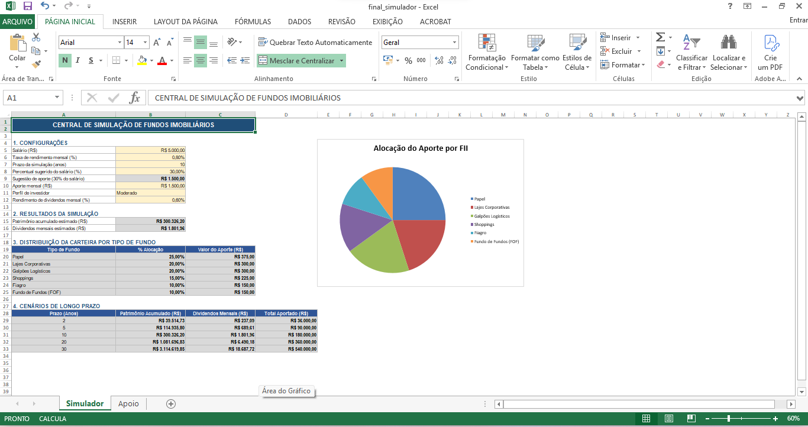
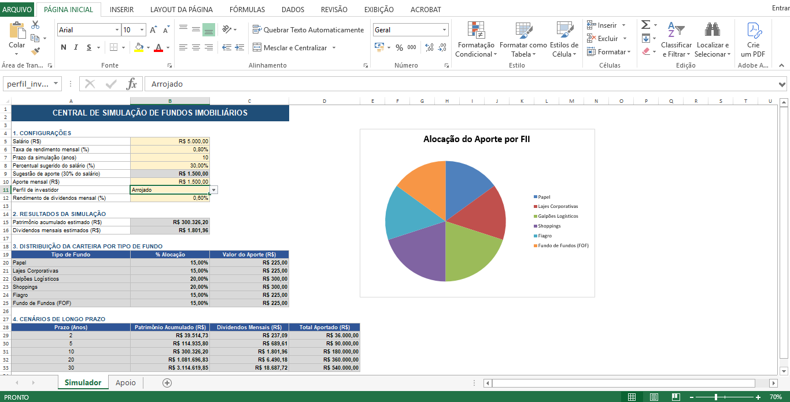

# Simulador de Investimentos em Fundos Imobiliários (FIIs)

Ferramenta desenvolvida em Excel com foco em usabilidade e design limpo (estilo aplicativo), projetada para auxiliar no planejamento financeiro de investimentos em Fundos Imobiliários, desde os aportes mensais até a projeção de patrimônio e dividendos.

## 1. As Perguntas de Negócio Respondidas

A ferramenta foi estruturada para responder diretamente a cinco perguntas fundamentais de planejamento financeiro:

- Quanto investir por mês? Localizada na célula de aporte mensal (B10).
- Por quantos anos? Localizada no campo de prazo da simulação (B7).
- Qual a taxa de rendimento mensal? Localizada na taxa de rendimento (B6).
- Quanto de patrimônio vai acumular? Exibida no resultado principal (B15) e detalhada na tabela de cenários.
- Quanto vai receber de dividendos por mês? Exibida na linha de dividendos mensais estimados (B16).

## 2. Intervalos Nomeados Criados

Para facilitar a legibilidade das fórmulas e garantir robustez caso a estrutura de linhas mude, foram criados os seguintes intervalos nomeados na planilha:

- `salario` (Simulador!$B$5): Representa o valor bruto do salário inserido.
- `taxa_mensal` (Simulador!$B$6): Armazena a taxa de rendimento esperada por mês.
- `prazo_anos` (Simulador!$B$7): Define o tempo total da simulação em anos.
- `perc_sugestao` (Simulador!$B$8): Armazena o percentual de referência (30%) usado para o cálculo da sugestão de aporte.
- `aporte` (Simulador!$B$10): O valor efetivo em Reais escolhido para o aporte mensal.
- `perfil_investidor` (Simulador!$B$11): O perfil selecionado na lista suspensa (Conservador, Moderado ou Arrojado).
- `div_mensal` (Simulador!$B$12): O percentual de dividend yield estimado (0,6% ao mês).

## 3. Como o VF e o PROCV Entram nos Cálculos

### A Função VF (Valor Futuro)

Para projetar o montante acumulado ao longo do tempo, utilizei a função `=VF(taxa; nper; pgto; vp; tipo)` com os seguintes argumentos:

- `taxa` (`taxa_mensal`): A taxa de rendimento mensal aplicada sobre o capital.
- `nper` (`prazo_anos*12`): O número total de períodos (meses), obtido multiplicando o prazo em anos por 12.
- `pgto` (`-aporte`): O valor do aporte mensal com sinal negativo. O Excel trata por convenção financeira o dinheiro investido (que sai do bolso) como uma saída, fazendo com que o patrimônio final retorne com sinal positivo. Se o sinal negativo for removido, o resultado do patrimônio final ficará negativo.
- `vp` (0): O valor presente, definido como zero por não haver um montante inicial já investido.
- `tipo` (0): Indica que os aportes ocorrem no fim de cada período (mês).

### O PROCV com Chave Composta

Para distribuir o aporte entre os 6 tipos de fundos imobiliários com base no perfil escolhido, utilizei a estrutura `=PROCV(valor_procurado; matriz; núm_índice_coluna; procurar_intervalo)`:

- `valor_procurado` (`perfil_investidor & A20`): Uma chave composta que une o perfil selecionado ao nome do fundo da linha atual (por exemplo, `ModeradoPapel`). O PROCV tradicional busca apenas na primeira coluna da matriz, por isso a chave composta é essencial para identificar cada linha de forma única.
- `matriz` (`Apoio!$A$3:$D$20`): A tabela de referência localizada na aba de apoio.
- `núm_índice_coluna` (4): A coluna que retorna o percentual de alocação (% Alocação).
- `FALSE`: Força a correspondência exata, garantindo que o Excel não busque valores aproximados em campos de texto.

## 4. Percentuais e Premissas de Dados

Percentuais de alocação: Os percentuais de distribuição por tipo de fundo (Papel, Lajes, Shoppings, etc.) foram adaptados e criados por mim com base em exemplos didáticos de alocação de mercado para cada perfil (Conservador, Moderado e Arrojado), garantindo que a soma de cada perfil resulte exatamente em 100%. Não constituem recomendação de investimento.

Taxa de dividendos (0,6%): Veio como exemplo da minha planilha original, servindo para ilustrar o cálculo do rendimento mensal gerado sobre o patrimônio acumulado (multiplicando o patrimônio em B15 pela taxa de dividendos em B12).

## 5. O Que Mudou em Relação ao Modelo Base

- Entrada do percentual de 30% (B8): O percentual de sugestão foi colocado como uma célula de entrada editável pelo usuário, permitindo flexibilizar a regra de alocação.
- Taxa de dividendos como entrada (B12): O percentual de rendimento de dividendos foi isolado em uma célula de parâmetro, facilitando simulações de diferentes yields.
- Chave composta na aba Apoio: Implementação da coluna unificada na aba de apoio para permitir o cruzamento correto via PROCV.
- Padronização visual e cores orientativas: Ocultação das linhas de grade para um aspecto profissional e coloração cinza em todas as células calculadas (inclusive na fórmula da chave composta na aba Apoio), servindo como guia de proteção para o usuário.

## 6. Evidências de Funcionamento (Prints)

Abaixo estão os prints que demonstram o comportamento dinâmico da ferramenta ao alternar entre diferentes perfis de investimento, comprovando o funcionamento da lista suspensa, do PROCV com chave composta e do gráfico de pizza:

**Figura 1 – Simulação utilizando o Perfil Moderado:**

**Figura 2 – Simulação utilizando o Perfil Arrojado:**

